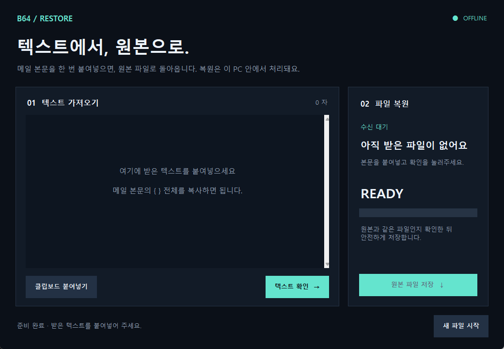

# Base64 Transfer

안드로이드 파일을 Base64 텍스트로 전달하고 PC에서 원본 파일로 복원합니다.

## 다운로드

- [안드로이드 테스트 APK 다운로드](https://github.com/Hwangchulha/base64-transfer/releases/latest/download/base64-transfer-debug.apk)
- [Windows 복원 EXE 다운로드](https://github.com/Hwangchulha/base64-transfer/releases/latest/download/Base64Restore.exe)
- [APK·PC 복원 프로그램 전체 ZIP 다운로드](https://github.com/Hwangchulha/base64-transfer/releases/latest/download/base64-transfer.zip)
- [릴리스 안내](https://github.com/Hwangchulha/base64-transfer/releases/latest)

APK는 Android 8.0 이상용 테스트 서명 버전입니다. Gmail 작성 화면에서 사용자가 직접 전송합니다.

## 사용 방법

1. 안드로이드 앱에서 1MiB 미만 파일을 선택합니다. **분할하지 않습니다.**
2. **Gmail로 작성** 또는 **텍스트 복사**를 선택합니다.
3. 작은 본문은 자동 입력됩니다. 큰 본문은 복사 후 Gmail에서 **붙여넣기 한 번**을 합니다.
4. PC에서 메일 본문 전체를 붙여넣고 **텍스트 확인 → 원본 파일 저장**을 누릅니다.

큰 본문은 내용 전체 대신 읽기 전용 텍스트 스트림을 클립보드에 전달합니다.
**받는 앱이 이 붙여넣기를 지원해야 하며, 실제 Gmail 기기 호환성은 아직 미검증입니다.**
추가 Google 계정 연결이나 첨부파일은 사용하지 않습니다.
클립보드는 PC로 자동 전송되지 않으며 Base64는 암호화가 아닙니다.
PC 프로그램은 이전 v1 분할 형식도 읽을 수 있습니다. 긴 본문은 전체 내용을 보관하고 화면에는 짧은 미리보기만 표시합니다.
붙여넣기 지연 개선 결과는 [성능 검증 기록](docs/PERFORMANCE.txt)을 참고하세요.



PC EXE 실행: `Base64Restore.exe`를 실행합니다. Python을 별도 설치할 필요가 없습니다.
PC 소스 실행: Python 3.9 이상과 Tk 설치 후 `pc/launch.cmd`를 실행합니다.
Windows EXE 빌드: PyInstaller가 설치된 Windows에서 `python pc/build_windows.py`를 실행합니다.

자세한 설명: [시작 안내](START-HERE.txt), [Android](android/README.txt), [PC](pc/README.txt).

## 검증

```sh
python3 -m unittest discover -s pc -v
```

Android 빌드 및 프로토콜 테스트는 `android/README.txt`를 참고하세요.
실제 휴대폰의 Gmail과 클립보드 연동은 기기별 확인이 필요합니다.
